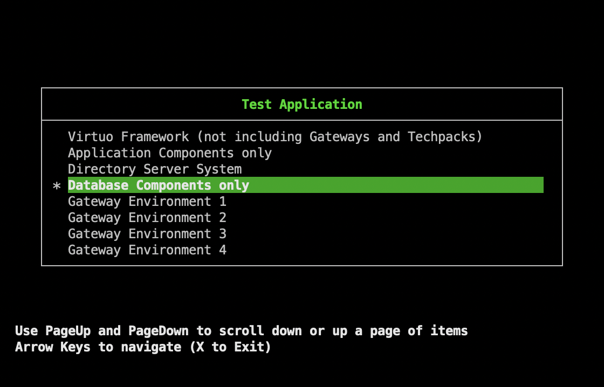

# tcmenu - Terminal Curses Menu

A simple, lightweight menu application using ncurses.




## Building

### Using autoconf (recommended)

```bash
./bootstrap.sh
./configure
make
```

### Manual build (if autoconf not available)

```bash
cc -std=c89 -Wall -Wextra -c tcmenu.c
cc -std=c89 -Wall -Wextra -c main.c
cc -o tcmenu tcmenu.o main.o -lmenu -lncurses
```

## Usage

```bash
./tcmenu --title "Menu Title" --entry "Option 1" "Option 2" "Option 3"
```

Or get help:

```bash
./tcmenu --help
```

### Options

- `-t, --title TEXT` - Set menu title
- `-e, --entry` - Start menu entries (all following args are entries)
- `-x, --exit` - Allow 'X' key to exit with code -3
- `-d, --default N` - Return zero-based selection N without opening a menu; with `-i`, preselect N interactively
- `-f, --fd N` - Output result to file descriptor N
- `-i, --interactive` - Force interactive mode
- `--theme THEME` - Set color theme: `dark`, `light`, `nocolor`, or `simple` (auto-detected by default)
- `-h, --help` - Display help message

### Themes

The application supports four themes:

- **dark** - Bright white text on black background with dark green accents
  - Background: black
  - Foreground: bright white
  - Title: dark green
  - Selection: white on dark green background
  - Default for most terminals

- **light** - Black text on bright white background with dark green accents
  - Background: bright white
  - Foreground: black
  - Title: dark green
  - Selection: bright white on dark green background

- **simple** - No colors or borders

- **nocolor** - No colors, reverse video only
  - Default for non-color terminals

The theme is auto-detected based on the `TERM` environment variable, but can be overridden with `--theme`.

## Script examples

See [examples/README.md](examples/README.md) for result capture and script dispatch.

```sh
./examples/menu-actions.sh                     # Select and invoke a script
./examples/default-action.sh                   # Invoke default action unattended
./examples/default-action.sh --interactive     # Confirm or change the default
```

All options precede `--entry`. Without `--default`, menus are interactive.
X is enabled only with `--exit`. Selection indexes are zero-based and are both
printed (stderr by default) and returned as exit statuses. Shell statuses wrap
modulo 256, so scripts should capture the printed value using `--fd`.
Errors return negative results; invalid option values return status 2. Interrupted
runs print no selection and exit with `128 + signal number`.

## Library ownership and Unicode

Call `setlocale(LC_ALL, "")` before displaying multibyte text. Unicode requires a
UTF-8 locale and wide-character curses/menu libraries. Configure prefers
`ncursesw`/`menuw`; macOS provides wide-character support under the traditional
library names. On Linux, use `-lmenuw -lncursesw` for a manual Unicode build.

`tc_init_display(theme)` owns terminal initialization and `tc_end_display()` ends
that display. To embed in an existing curses client, initialize curses yourself,
then call `tc_attach_display(theme)`: ending the tcmenu display only detaches it.
The caller owns input modes, locale, signal handlers, and final `endwin()` in this
case. Color themes reserve pairs 1–5. Only one active screen is supported; the
API is not thread-safe. Free all menus before ending or detaching a display.

The library installs no signal handlers. The CLI's handlers only set a
`sig_atomic_t` flag; normal control flow frees menus and restores the terminal.
`tc_query_menu_interruptible` accepts a caller-owned flag and assumes stdin is
the curses input stream. For custom `newterm` streams, use `tc_query_menu`.

## Testing

```sh
make
python3 tests/regression.py
python3 tests/examples.py
cc -std=c89 -Wall -Wextra -pedantic -fsanitize=address,undefined -g \
    tests/library.c -o /tmp/tcmenu-library-test -lmenu -lncurses
LC_ALL=en_US.UTF-8 /tmp/tcmenu-library-test < /dev/null
```

Use an installed UTF-8 locale and the platform's wide curses libraries. The
library check verifies 1,000 create/query/free cycles, resource counters,
subwindow/setup failure cleanup, EOF, Unicode truncation, and caller ownership.
The Python checks exercise CLI behavior and invoking scripts through a pseudo-terminal.
`./tctest` remains available for a manual visual check.
